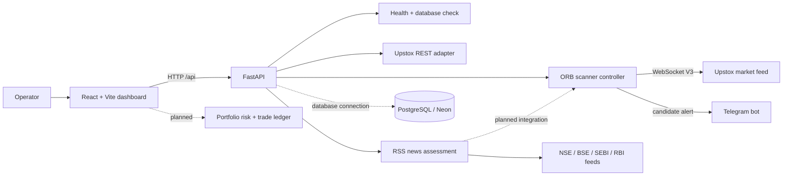

# Web Dashboard and System Architecture

## Purpose

The web client is an operations console for an NSE intraday, manual-execution research system. It must make backend state visible without presenting missing data as live market intelligence. The UI is not an order terminal and does not place broker orders.

## Runtime topology

## Frontend

- React + TypeScript + Vite.
- Tailwind CSS for responsive dark operations UI.
- TanStack Query polls service status every five seconds.
- Axios calls same-origin `/api` routes; local Vite proxy / production routing must forward these paths to FastAPI.
- Tabs: Live overview, News & events, System architecture.
- News is fetched only when the operator clicks the assessment action. It is deliberately not polled every five seconds.
- The UI labels configured credentials separately from a confirmed connected feed.
- The UI shows the database connection state only; it must not display the database URL or secret values.

## Existing API contract used by the dashboard

| Endpoint | Method | Purpose | UI |
|---|---|---|---|
| `/api/health` | GET | API + database health | Health cards |
| `/api/integrations/status` | GET | Presence of Upstox and Telegram config | Dependency map |
| `/api/scanner/status` | GET | Scanner running/connection/symbols/timestamps/error | Live scanner |
| `/api/scanner/start` | POST | Resolve configured NSE equities and start stream | Start button |
| `/api/scanner/stop` | POST | Stop scanner | Stop button |
| `/api/notifications/test` | POST | Send explicit demo Telegram message | Demo alert button |
| `/api/research/news/assess` | POST | Fetch configured RSS feeds and assess news | News page |

Other implemented market-data routes include:
- `GET /api/market-data/ltp`
- `GET /api/market-data/quotes`
- `GET /api/market-data/market-status`
- `GET /api/market-data/holidays`
- `GET /api/market-data/candles/intraday`
- `GET /api/market-data/candles/historical`
- `POST /api/instruments/refresh`
- `GET /api/instruments/search`

Interactive API reference is exposed by FastAPI at `/docs`.

## Current backend data path

1. Operator starts scanner from dashboard.
2. FastAPI checks Upstox and Telegram credentials are configured.
3. Backend refreshes the Upstox NSE equity instrument master and resolves configured symbols.
4. A background thread runs the Upstox Market Data Feed V3 WebSocket.
5. The ORB evaluator builds five-minute bars from the stream and checks completed-bar breakout rules.
6. Scanner state is exposed through `/api/scanner/status`; candidate alerts are sent to Telegram.
7. Dashboard polls status every five seconds.

The current default symbol configuration is a NIFTY 50-style list, not the requested NIFTY 200 universe. The scanner is experimental ORB only.

## News data path

1. Operator requests an assessment from the News & events tab.
2. FastAPI reads `NEWS_RSS_FEED_URLS`.
3. The backend fetches configured HTTPS RSS/Atom feeds from the official-domain allowlist.
4. It filters stale/future-dated items, deduplicates URLs, classifies source trust, event severity, symbol tags and baseline keyword sentiment.
5. It returns coverage state, risk state, reasons, article summaries and feed errors.
6. The dashboard displays the response.

This is on-demand ingestion. There is no scheduler, background worker, event persistence, continuous monitoring, or live scanner gate yet. The sentiment score is not a calibrated probability and is not a price forecast.

## Risk policy vs implementation

Research limits currently encoded in the risk module:
- Capital: ₹50,000.
- Planned risk per trade: ₹250.
- Aggregate open planned risk: ₹500.
- Concurrent positions: 2.
- New entries per day: 3.
- Daily loss stop: ₹750.
- Entry window: 09:30–14:45 IST.
- Mandatory square-off: 15:15 IST.

The risk manager is broker-agnostic and unit-tested, but is not currently connected to live scanner signals, broker positions, order execution, or automatic flattening. The dashboard intentionally labels it as policy-only, not active protection.

## Planned integration sequence

1. Add a typed candidate API and persistent candidate/event ledger.
2. Implement NIFTY 200 point-in-time universe and instrument mapping.
3. Build market regime, sector relative strength, time-adjusted RVOL, liquidity and volatility feature services.
4. Add a background news worker with source freshness watchdog, deduplication, audit persistence and Telegram/dashboard event delivery.
5. Connect verified news events and risk decisions to a shared pre-trade decision service.
6. Add broker-position reconciliation and manual trade journal; keep order placement disabled.
7. Upgrade backtester to multi-position portfolio simulation and walk-forward evaluation.
8. Expose only validated, timestamped outputs to the UI.

## UI truthfulness rules

- Never invent market breadth, India VIX, P&L, win rate, positions or signals when the backend does not provide them.
- Distinguish `configured`, `connected`, `fresh`, and `available`.
- Show timestamps and stale-data warnings for every live feed.
- A feed being connected does not mean there is a valid trade setup.
- A news `BLOCKED` state means pause new entries; it does not close open positions.
- Risk limits are not live protection until position and order state is synchronized.
- No automatic orders; manual execution remains the operating mode.
